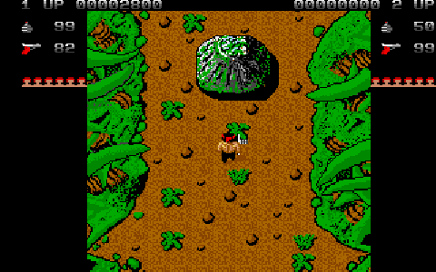
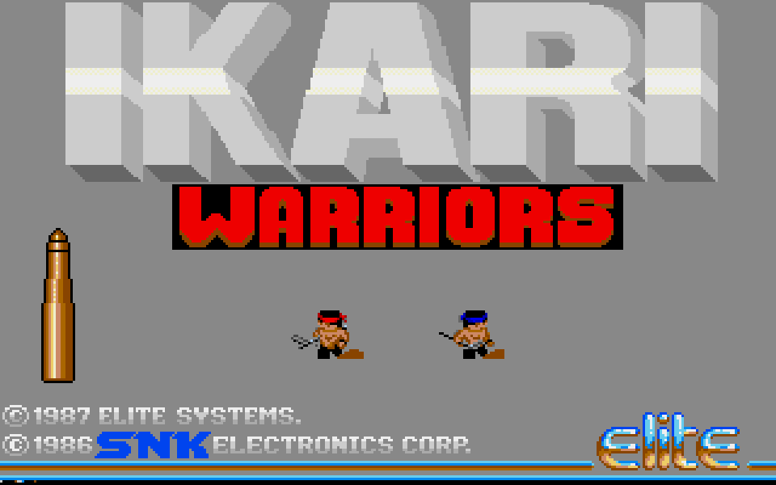
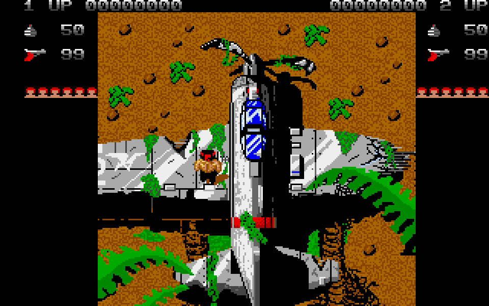
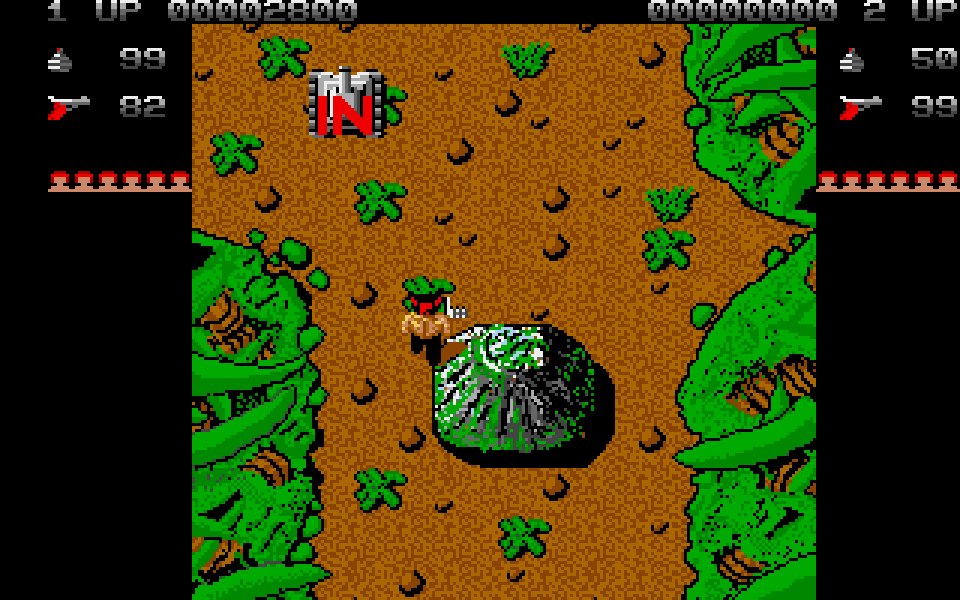
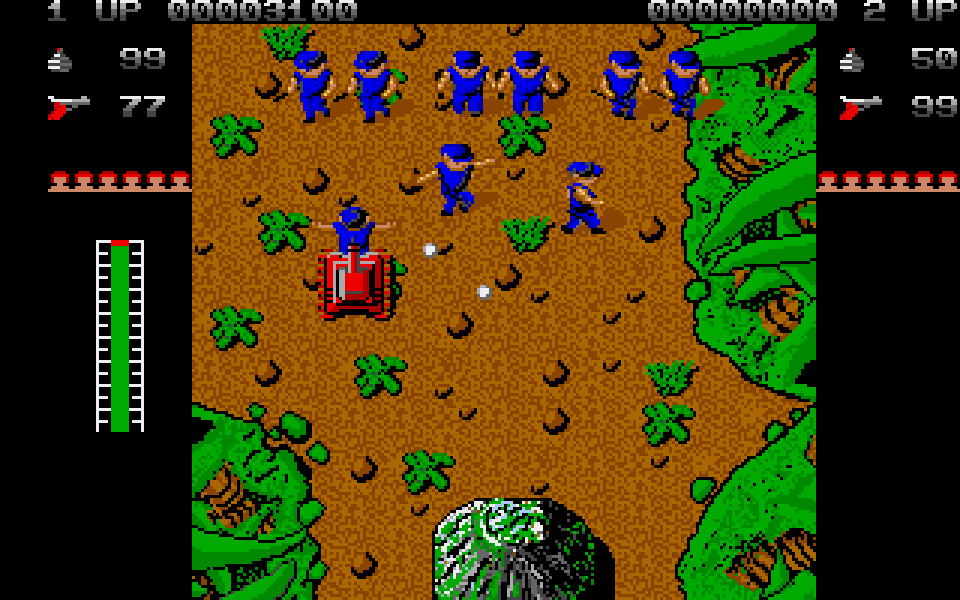
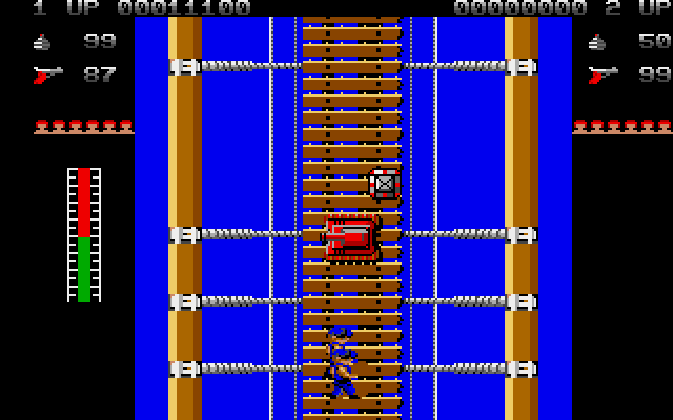
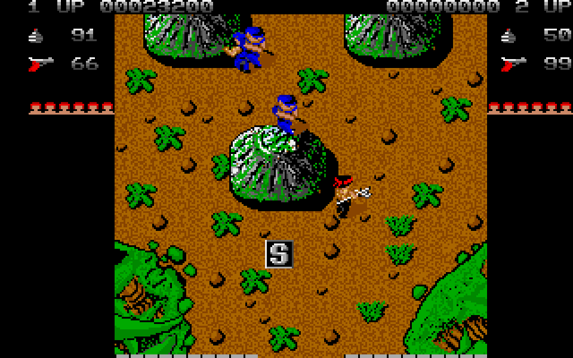
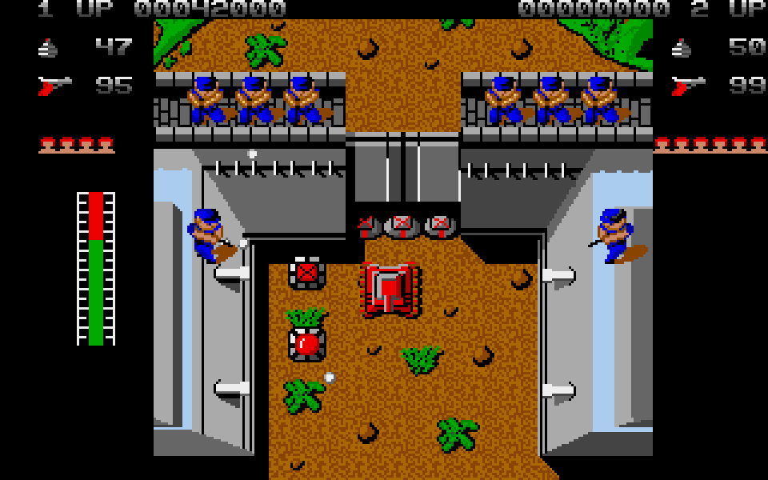
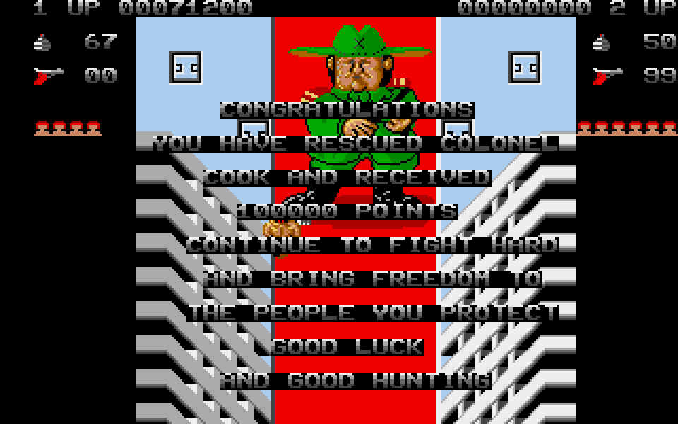
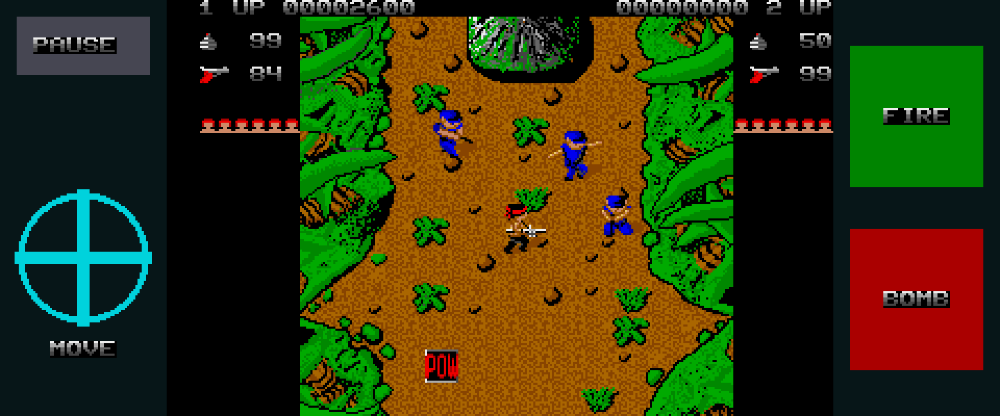

# Ikari Warriors Go

A native Go/Ebitengine remake of **Ikari Warriors** for desktop and Android.
Play alone or with a second player, cross the scrolling battlefield, collect
supplies, commandeer tanks and reach the final stronghold. It opens directly
on the original game title and includes the original graphics and audio.



[Watch the full presentation video](media/ikariwarriors-demo.mp4) ·
[WebM version](media/ikariwarriors-demo.webm)

## Desktop

Go 1.26 or newer and a desktop graphics environment are required.
The runtime assets are included; no preparation step is needed to play.

```sh
go run .
```

Build and run a standalone executable:

```sh
make build
./bin/ikariwarriors
```

Useful launch options:

```sh
go run . -fullscreen # Start in fullscreen mode.
go run . -demo       # Start the automatic demonstration.
go run . -touch      # Preview the Android touch layout.
go run . -mute       # Disable audio.
go run . -scale 4    # Select an initial window scale from 1 to 8.
```

The game renders at the original 320 × 200 resolution with nearest-neighbor
scaling. After 15 idle seconds on the title screen, an automatic player starts
a demonstration with ordinary lives and ammunition.

## Controls

| Input | Action |
| --- | --- |
| 1 | Start a one-player game |
| 2 | Start a simultaneous two-player game |
| Arrow keys or WASD | Move Player One |
| Z | Fire; hold to throw a grenade |
| X | Throw a grenade or enter/leave a tank |
| Space | Lock or unlock Player One's firing direction |
| I, J, K, L | Move Player Two |
| O | Player Two fire; hold to throw a grenade |
| U | Player Two grenade |
| Y | Lock or unlock Player Two's firing direction |
| F2 or P | Pause or resume |
| F1 or Escape | Return to the title |

Hold Fire or press X/Bomb beside an empty tank to enter it; use the same
action to leave. While your previous tank is still burning, the action throws
a grenade instead of boarding another vehicle.
Fuel follows the original 64-unit gauge and each player's consumption phase.
A burning tank can still move; leave it before the escape interval ends.
Tanks cannot enter river tiles that infantry can cross on foot.

Standard gamepads use the left stick or D-pad, the primary button for fire,
the secondary button for grenades, and Start for pause.

## Android

The Android build requires Go 1.26+, Java 17 or 21, Android SDK 36,
Android Build Tools 36.0.0 and Android NDK 28.2.13676358. Set `ANDROID_HOME`
or `ANDROID_SDK_ROOT` when the SDK is not installed in a standard location.

Build the ARM64 debug APK:

```sh
make android
```

Build, install and launch on one authorized USB device:

```sh
make android-run
```

The APK is written to:

```text
android/app/build/outputs/apk/debug/app-debug.apk
```

The landscape layout preserves the original image, with a movement stick
and Pause on the left and Fire and Bomb on the right. Bomb also enters or
leaves a tank when the action is available. Returning from the background
pauses a manual game and releases pending touch input.

## Screenshots

| Official title | Landing sequence |
| --- | --- |
|  |  |

| Opening combat | Tank combat |
| --- | --- |
|  |  |

| Wooden bridge | Jungle |
| --- | --- |
|  |  |

| Bunker approach | Original ending |
| --- | --- |
|  |  |

| Android touch controls |
| --- |
|  |

## Original game credits

The original title credits **Mark Bullock** and **Neil Metcalfe** for the 68000
code, **P. Frankish** for the Amiga adaptation, **P. Tattershall** for graphics,
and **T. C. Brooks** for music. The game was published by **Elite Systems Ltd**
and is based on SNK's original Ikari Warriors.

Ikari Warriors, its name, artwork, game data, and audio remain the property of
their respective rights holders. This independent preservation remake is not
affiliated with or endorsed by them.

No Amiga disk image is distributed in this repository. See [ADF.md](ADF.md)
for the reference version used by the project.
